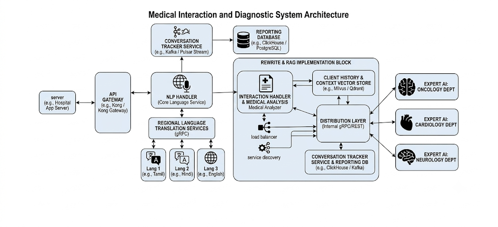

# OPD Pre-Consultation AI Platform

An edge-capable, multimodal AI system that reduces Out-Patient Department (OPD) wait times by capturing structured clinical histories **before** the doctor's consultation — via regional-language voice intake and digitized paper records — and packaging the result as an ABDM-compliant FHIR R4 bundle mapped to NAMASTE and ICD-11 codes.

The goal: maximize the physician's active diagnostic time by handing them a pre-structured, coded patient history instead of a blank slate.

## Architecture

## How It Works

### 1. Intake
- **Server ↔ API Gateway** — all client/device traffic (kiosk, app, or edge device) enters through a single gateway.
- **Language Distributor** — routes speech/text input to the correct regional-language model (`lang 1`, `lang 2`, `lang 3`, powered by **Bhashini**) so patients can converse in their native language.

### 2. NLP Handler (Language Layer)
- Receives the routed input and:
  1. Handles the regional language (transcription / translation to a working language).
  2. Processes it for the downstream interaction AI.
- Exchanges **"AI question and user response"** turns with the API Gateway to drive the conversation.
- Feeds a **Conversation Tracker**, which logs the dialogue for report generation and writes to the **Report DB**.

### 3. Interaction Handler (Medical Analysis / RAG Layer)
- Takes the processed input from the NLP handler.
- Processes the conversation using **RAG (Retrieval-Augmented Generation)** grounded in a **Database of Client History** (past visits, records).
- Determines and asks the patient the next clinically relevant question.
- Also digitizes any paper records the patient brings in, using **LayoutLMv3**, and merges that into the structured history.

### 4. Distributor AI → Expert AI Departments
- Once symptoms/history are gathered, the **Distributor AI** routes the case to the relevant specialist model(s):
  - Expert AI — Dept 1
  - Expert AI — Dept 2
  - Expert AI — Dept 3
- Each department AI can request further clarification, closing the loop back through the distributor.

### 5. Structured Output
- The final synthesized history is mapped from free-text/traditional symptom descriptions to **NAMASTE** and **ICD-11** codes and assembled into an **ABDM-compliant FHIR R4 bundle**, ready for the physician's EHR before the consultation begins.

## Key Components

| Component | Role |
|---|---|
| API Gateway | Single entry/exit point between server and AI pipeline |
| Language Distributor | Routes to regional-language models (Bhashini) |
| NLP Handler | Language processing; drives Q&A turns |
| Conversation Tracker | Logs dialogue for report generation → Report DB |
| Interaction Handler | RAG-based medical reasoning over conversation + client history |
| Client History DB | Source data for RAG retrieval |
| Distributor AI | Routes cases to the correct specialist department |
| Expert AI (Dept 1–3) | Department-specific diagnostic reasoning |

## Core Technologies

- **Bhashini** — regional Indian language speech/text processing
- **LayoutLMv3** — digitization of paper medical records
- **RAG (Retrieval-Augmented Generation)** — grounds interaction AI in patient history
- **NAMASTE & ICD-11 code mapping** — standardizes traditional/symptom terminology
- **ABDM-compliant FHIR R4** — output format for interoperability with India's Ayushman Bharat Digital Mission

## Status

This repository currently documents the system architecture. Implementation details, setup instructions, and API references will be added as modules are built out.

## Contributing

Contributions, issues, and architecture discussions are welcome — please open an issue before submitting large changes.

## License

_Add license here._